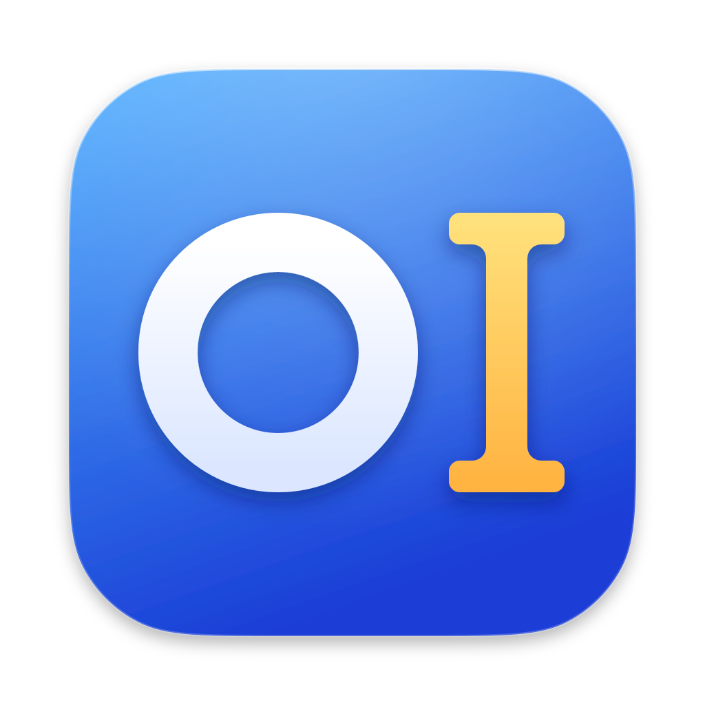

<div align="center">



# OI

**原生 macOS 菜单栏启动器**

按 `⌥Space` 呼出 Spotlight 风格的面板：启动应用、查找文件、即时计算、打开网址、向 AI 提问；<br>
在任意应用中用力点按、按 `⌥D` 或框选屏幕，就地翻译。

[](https://github.com/AND-Q/OI/releases/latest)


[English](README.en.md) · 中文

[下载](https://github.com/AND-Q/OI/releases/latest) · [使用指南](docs/OI%20使用指南.md) · [功能清单](docs/OI%20功能清单.md)

</div>

## 功能

### 启动器

- **应用搜索**：中英文名、拼音全拼（`weixin`）、首字母（`wx`、`vsc`）、Bundle ID 与模糊跳字都能命中；先按匹配等级、再按使用频次排序。索引在内存中完成，不联网。
- **文件搜索**：借助系统 Spotlight 索引检索家目录下的文件与文件夹，分组列在应用之后；输入以 `/` 或 `~` 开头的路径可直接打开，隐藏文件与 `~/Library` 也可以。
- **快速查询**：输入算式即时求值（`2^10`、`(8-5)/3`），输入 `ip` 查看本机局域网地址，回车复制结果。
- **网址与网页搜索**：输入 `github.com`、`localhost:3000` 回车直接打开；`⌘Enter` 用必应、Google、百度或 DuckDuckGo 搜索当前输入。
- **结果操作**：`⌘F` 在 Finder 中显示，`⌘Y` 用 Quick Look 预览，`⌘K` 打开快捷操作（复制路径、复制 Bundle ID、在终端中打开、用其他 App 打开）。

### AI 与翻译

- **Quick AI**：在面板中按 `Tab` 提问，回答后可接着追问，收起后 5 分钟内再呼出可回到对话，接入任意 OpenAI 兼容接口（包括 Ollama 等本地模型），流式显示 Markdown 回答。
- **划词翻译**：触控板用力点按翻译光标下的单词，`⌥D` 翻译选中的文字（未选中时翻译剪贴板），译文在原文旁的气泡中流式显示；气泡可拖动、可固定，可用系统语音离线朗读原文。
- **截图翻译**：图片、视频字幕等取不到文字的地方，按 `⌥S` 框选屏幕区域，在本机识别文字后翻译。

### 其他

- 简体中文与英文界面：跟随系统语言，也可在「设置… → 通用 → 界面语言」中指定。
- 开机自启；呼出、翻译、截图翻译三个全局快捷键均可自定义。
- Quick AI 与划词翻译可以使用不同的接口和模型，API Key 保存在钥匙串中。
- 菜单栏「检查更新…」查询 GitHub 上的新版本并显示更新日志。

## 安装

系统要求 macOS 27.0 或更高版本。用力点按取词需要支持 Force Touch 的触控板，没有时可以用 `⌥D` 翻译。

1. 从 [Releases](https://github.com/AND-Q/OI/releases/latest) 下载 `OI-<版本号>.dmg`，打开后把 OI 拖到「应用程序」文件夹。
2. OI 没有经过 Apple 公证，第一次打开时系统会提示无法验证。点「完成」，再到「系统设置 → 隐私与安全性」页面下方点「仍要打开」并确认；也可以在终端执行：

   ```bash
   xattr -dr com.apple.quarantine /Applications/OI.app
   ```

3. OI 启动后常驻菜单栏（`⌘` 图标），没有 Dock 图标。按 `⌥Space` 呼出启动器，点菜单栏图标 →「设置…」调整选项。

> [!NOTE]
> **升级后需要重新授权**：OI 没有使用开发者证书签名，系统会把每个新版本当作不同的应用。升级后如果划词翻译或截图翻译不工作，请在「系统设置 → 隐私与安全性」的「辅助功能」和「屏幕与系统录音」列表中删除旧的 OI，再从 OI 设置的「取词环境」重新授权。

## 快捷键

全局快捷键（在任何应用中生效，可在设置中修改）：

| 按键 | 作用 |
| --- | --- |
| `⌥Space` | 呼出 / 隐藏启动器 |
| `⌥D` | 翻译选中的文字，未选中时翻译剪贴板 |
| `⌥S` | 框选屏幕区域，识别文字并翻译 |
| 触控板用力点按 | 翻译光标下的单词 |

启动器面板中：

| 按键 | 作用 |
| --- | --- |
| `↑` / `↓` | 移动选中项 |
| `Enter` | 打开应用、文件或网址；选中查询结果时复制 |
| `⌘Enter` | 用网页搜索当前输入 |
| `Tab` | 进入 / 退出 Quick AI |
| `⌘F` | 在 Finder 中显示；选中查询结果或网址时复制 |
| `⌘Y` | Quick Look 预览 |
| `⌘K` | 快捷操作菜单 |
| `Esc` | 输入框有内容时先清空，再按关闭面板 |

翻译气泡中：`Enter` 复制译文并关闭，`⌘C` 复制，`⌘⇧S` 朗读原文，`Esc` 收起，`⌘W` 关闭。

## 搜索示例

| 输入 | 找到 | 匹配方式 |
| --- | --- | --- |
| `weixin` / `xin` | 微信 | 拼音全拼，可从任意一个字开始 |
| `wx` | 微信 | 拼音首字母 |
| `vsc` | Visual Studio Code | 英文首字母 |
| `code` | Visual Studio Code | 单词前缀 |
| `com.apple.Saf` | Safari | Bundle ID |
| `visulstdo` | Visual Studio Code | 模糊跳字 |

匹配分 8 个等级：完全匹配 → 名称前缀 → 单词前缀 → 包名与 Bundle ID → 别名与首字母 → 拼音全拼 → 子串包含 → 模糊匹配。等级绝对优先，启动次数与最近使用时间只在同一等级内排序，所以越常用的应用越靠前。

## 配置 Quick AI 与划词翻译

在「设置… → Quick AI」和「设置… → 划词翻译」中分别填写接口地址、模型与 API Key：

- 接口地址填 OpenAI 兼容服务的地址，例如 `https://api.openai.com/v1`；本机 Ollama 填 `http://localhost:11434/v1`，API Key 留空即可。
- 填好后可点「测试连接」确认地址与 API Key 是否正确，或点「获取模型」从服务的模型列表中选择模型。
- 翻译建议选用响应快、不带思考的模型，或把思考强度设为 `low`。

## 权限与隐私

| 权限 | 用途 | 何时请求 |
| --- | --- | --- |
| 桌面、文稿、下载文件夹 | 文件搜索 | 首次启动；关闭文件搜索后不再请求 |
| 辅助功能 | 读取选中的文字与光标下的单词 | 在「设置… → 取词环境」中开启 |
| 屏幕录制 | 截图翻译 | 第一次按 `⌥S` 时 |
| 通知 | 打开应用或文件失败时说明原因 | 第一次需要时 |

- 应用搜索、文件搜索与快速查询都在本地完成，不记录搜索词，也不记录文件打开历史；只保存应用的启动次数与最近使用时间用于排序，可在设置中关闭。
- 只有 Quick AI 提问和翻译时，问题或原文会发送到你填写的接口（追问时连同这段对话此前的问答）。截图只在本机识别，不保存也不上传，发送的只有识别出的文字。
- 按 `⌥D` 时如果辅助功能读不到选中的文字（如 Chrome 网页、预览中的 PDF），OI 会模拟按一次 `⌘C` 读出选区，读完立即恢复剪贴板原来的内容；剪贴板管理器可能记下这一次复制。
- 除此之外，只有在设置中点「获取模型」「测试连接」时会向你填写的接口读取模型列表（不发送提问或原文），以及手动选择「检查更新…」时会访问 GitHub。

## 常见问题

**按 `⌥Space` 没有反应？**
部分输入法把 `⌥Space` 用作全角/半角切换，也可能与其他常驻工具的快捷键冲突。在输入法设置中关掉它，或在「设置… → 通用」中换一个快捷键（被占用时会有红色提示）。

**用力点按时系统词典也一起弹出？**
在「系统设置 → 触控板 → 光标与点按」中把「查询与数据检测器」改为「用三个手指轻点」或关闭，同时保持「用力点按和触感反馈」开启。

**刚安装的应用搜不到？**
应用目录的变化会在下次呼出面板时自动刷新，呼出一次再搜即可。

更多问题见[使用指南 · 常见问题](docs/OI%20使用指南.md#15-常见问题)。

## 从源码构建

需要支持 macOS 27 SDK 的 Xcode。打开 `OI.xcodeproj`，选择共享的 `OI` scheme 运行；或使用命令行：

```bash
xcodebuild -project OI.xcodeproj -scheme OI -configuration Debug build
xcodebuild -project OI.xcodeproj -scheme OI -configuration Debug test -destination 'platform=macOS'
```

Debug、Release 与测试 target（`OITests`）都开启了完整严格并发检查，Release 启用 Hardened Runtime。OI 不启用 App Sandbox：它需要扫描系统应用、注册全局快捷键并通过辅助功能读取其他应用的文字，沙盒无法满足这些能力。

界面文字在代码中以中文书写，经 `Localizable.xcstrings` 提供英文与简体中文；新增或改动界面文字时，同时在目录中补上英文。

## 项目结构

项目采用「单 App Target + 明确分层 + Composition Root」架构，依赖方向如下：

```text
App -> Features -> Application -> Domain
App -> Infrastructure -> Application / Domain
App -> UI -> Features / Application / Domain
```

| 目录 | 职责 |
| --- | --- |
| `App/` | Composition Root：生命周期入口与协调；`AppDependencies.live(configuration:)` 是唯一创建具体依赖的地方 |
| `Domain/` | 业务模型（App、文件、搜索结果、快速查询、翻译语言），Foundation-only、`Sendable` |
| `Application/` | `Ports` 外部能力协议、`UseCases` 业务流程、`Search` 应用搜索索引与拼音归一化、`Errors` 稳定的错误模型 |
| `Features/` | 功能状态与视图模型：`Launcher`（搜索、快速查询、网址识别、`⌘K` 菜单）、`Settings`、`Translator`，以及共用的 Markdown 与流式文本 `Shared` |
| `Infrastructure/` | 系统能力实现：应用扫描与目录监听、Spotlight 文件检索、NSWorkspace 打开、Carbon 快捷键、登录项、OpenAI 兼容客户端与钥匙串、取词与截图识字、通知、更新查询、UserDefaults 存储 |
| `UI/` | AppKit / SwiftUI 桥接：启动器面板、菜单栏、设置窗口、翻译气泡与框选、图标缓存、更新提醒 |
| `OITests/` | 单元测试 |
| `assets/`、`scripts/` | 图标源文件、dmg 背景图与发布脚本 |
| `docs/` | 使用指南、功能清单、发布说明与待办 |

开发约定：

- Feature 不创建具体基础设施。跨层副作用先在 `Application/Ports` 定义协议，再由 `Infrastructure` 实现；用例把底层错误转换为 `ApplicationError`，Feature 再映射为界面文案。
- `NSImage`、`NSPanel`、`NSStatusItem` 等 UI 类型只出现在 `UI`；Domain 不引用 AppKit、SwiftUI 或 Carbon；Infrastructure 不依赖 Features 或 UI。
- Feature 用显式状态类型，避免多个布尔值形成相互矛盾的状态；新的用户流程新增独立 Feature，不把状态塞进 `LauncherViewModel`。
- `@MainActor` 只覆盖界面与 AppKit 协调，文件扫描等耗时操作在后台执行并支持取消。
- 测试通过 port stub、内存存储或自定义 `AppDependencies` 替换依赖，不使用全局单例。
- 不创建没有实际职责的 `Manager`、`Service`、`Repository` 或空目录。只有模块具有独立编译边界、独立所有者或显著构建收益时，才提取本地 Swift Package。

## 发布

OI 通过 GitHub Release 分发 dmg 安装包，不上架 App Store，也不使用 Developer ID 签名和公证（安装包为 ad-hoc 签名）。发布一个版本：

1. 递增 `MARKETING_VERSION` 与 `CURRENT_PROJECT_VERSION`，编写 `docs/releases/v<版本号>.md`，提交后运行全部测试。
2. 安装 dmgbuild（`pip3 install dmgbuild`），在干净的工作区执行 `scripts/release.sh`：编译 Release 版，打包为 `build/release/OI-<版本号>.dmg`（窗口布局见 `scripts/dmg-settings.py`），并生成附带 SHA-256 的发布说明。
3. 执行脚本最后打印的 `gh release create` 命令发布。

也可以在 Xcode 中 Archive，通过 Distribute App → Custom → Copy App 导出 `OI.app`，再用 `scripts/make-dmg.sh <OI.app> <版本号> <输出的 dmg>` 打包。

「检查更新…」按最新 Release 的标签与当前版本号比较，标签须为 `v<版本号>` 形式（如 `v1.1.0`，脚本给出的命令即是）；草稿与预发布版本不会被检查到。
